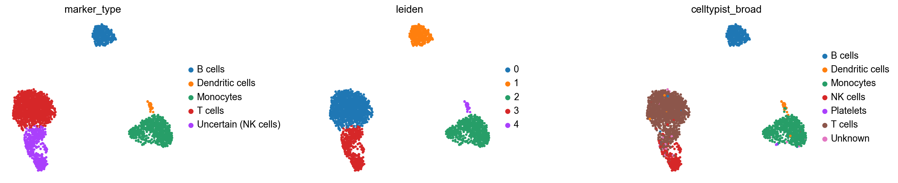
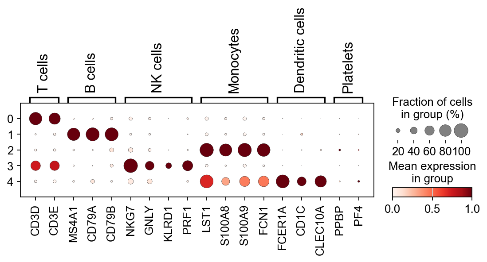
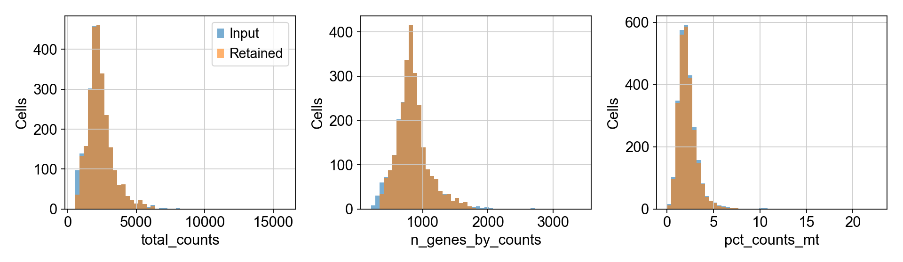
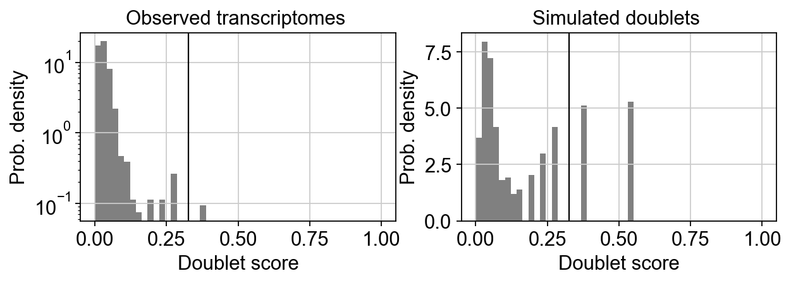

# Single-cell RNA-seq: PBMC cell-type annotation

## Question

Which broad cell types do clusters in a public healthy-donor PBMC dataset represent,
and how consistent are independent marker-based assignments with CellTypist predictions?

## Data

[10x Genomics PBMC3k](https://support.10xgenomics.com/single-cell-gene-expression/datasets/1.1.0/pbmc3k),
hg19 gene symbols, retrieved using [Scanpy's raw-count loader](https://scanpy.readthedocs.io/en/stable/generated/scanpy.datasets.pbmc3k.html).
The downloaded matrix contains **2,700 cells × 32,738 genes**.
Only public data and a public pretrained model are used. Input/model SHA-256 values
are recorded in [data_manifest.json](results/data_manifest.json). Raw downloads are
ignored by Git; the annotated result is committed.

## Approach

1. Calculate detected genes, total UMIs and mitochondrial percentage (`MT-`).
   Remove cells with fewer than 200 detected genes, mitochondrial fraction above
   10%, or log1p gene/count depth outside median ± 5 unscaled MADs. A constant
   metric does not flag outliers. Filter genes detected in fewer than 3 cells.
2. Run [Scrublet](https://scanpy.readthedocs.io/en/stable/generated/scanpy.pp.scrublet.html)
   on QC-passing raw counts, with an assumed doublet rate of 3% and an automatically
   selected threshold. Remove predicted doublets, retain their scores in the QC audit,
   then repeat the minimum-cell gene filter. Inspect the score distribution below.
3. Preserve sparse integer counts in `layers['counts']`. Normalize to 10,000
   counts per cell, log1p transform, select 2,000 Seurat-flavor HVGs, scale only
   HVGs (clip at 10), calculate 40 PCs, and build a 15-neighbor graph using 30 PCs.
   Run Leiden (resolution 0.5, igraph, two iterations) and UMAP; seed = 42.
4. Assign broad cluster labels from [explicit marker panels](src/pbmc_annotation/core.py).
   For each gene, z-score log expression across cells and clip to ±5, average within
   each panel, then average cell scores within clusters. Only retained marker genes
   are used, with at least two required per panel. The highest scoring panel
   wins. A top-two margin below 0.15 or a nonpositive top score is labelled
   `Uncertain (candidate)`. A cluster is also uncertain when fewer than 70% of its
   cells individually favor the winning panel. These are heuristic scores, not calibrated probabilities.
5. Independently apply [CellTypist](https://celltypist.readthedocs.io/en/latest/celltypist.annotate.html)
   `Immune_All_Low.pkl` to the full filtered log-normalized gene matrix, without
   majority voting. Collapse fine labels with an exact, exported dictionary;
   unrecognized labels remain `Unknown`. Compare per-cell broad labels against
   the cluster marker assignment. Unknown and uncertain assignments count as
   disagreements in the full denominator. No CellTypist label enters marker scoring. NK/T mixing observed in the first
   analysis motivated the explicitly reported 70% marker-support heuristic; this
   cutoff was not tuned against external reference labels.
6. Export Wilcoxon-ranked cluster markers (Benjamini–Hochberg-adjusted p values)
   as exploratory evidence; marker panels and ranked markers use the same cells,
   so these tests are not independent validation.

## Results

- QC retained **2,612/2,700 cells** and removed **88**.
- Scrublet flagged and removed **5** additional cells
  (automatic score threshold **0.3255**).
- Final matrix: **2,607 cells × 13,574 genes** in **5 clusters**.
- Uncertain clusters: **1**; affected cells: **437**.
- Marker/CellTypist broad agreement: **2,126/2,607
  (81.55%)**; unmapped model predictions: **29 cells**.
- Analysis runtime recorded by Python: **27.31 seconds** (downloads and
  environment setup excluded). Hardware-specific resource measurements are in
  [runtime.txt](results/runtime.txt).

| Cluster | Cells | Marker assignment | Score margin | Marker support | CellTypist broad mode | Agreement |
| --- | ---: | --- | ---: | ---: | --- | ---: |
| 0 | 1184 | T cells | 0.693 | 80.6% | T cells | 98.4% |
| 1 | 330 | B cells | 2.155 | 97.6% | B cells | 99.7% |
| 2 | 629 | Monocytes | 1.384 | 87.9% | Monocytes | 97.1% |
| 3 | 437 | Uncertain (NK cells) | 1.206 | 67.0% | T cells | 0.0% |
| 4 | 27 | Dendritic cells | 3.121 | 96.3% | Dendritic cells | 77.8% |

Cluster 3 is explicitly flagged as uncertain because marker support is below
70%; its cytotoxic profile contains both T and NK evidence. Candidate-label
agreement, ignoring uncertainty flags, is 2,331/2,607.
The cluster-level annotations support broad immune lineages; individual cell
agreement is a consistency measurement, **not annotation accuracy**. The complete
fine-label predictions and confidence scores remain available for inspection.





Dot size denotes the fraction of cells expressing a gene; color is mean log
expression scaled within each gene. Colors cannot be compared quantitatively
between genes.





## Reproduce

Python 3.11; Linux CPU run, no GPU required. Use the complete dependency snapshot:

```bash
conda env create -f environment.yml
conda activate p12-pbmc
bash scripts/run_analysis.sh
```

Alternatively create a Python 3.11 environment, then run:

```bash
python -m pip install -r requirements-lock.txt -e .
python -m pip check
bash scripts/run_analysis.sh
```

`requirements.txt` lists direct analysis dependencies; `requirements-lock.txt`
records the complete installed dependency versions. Downloads are cached under
`data/raw/` and `~/.celltypist/data/models/`. Downloading a changed model or matrix
fails the pinned SHA-256 check; review upstream changes before updating the pins.
The small marker subset and scaled HVGs are the only deliberately dense matrices.

## Deliverables and verification

- [Annotated AnnData](results/pbmc3k_annotated.h5ad): log expression in `X`, raw
  counts in `layers['counts']`, QC/doublet/annotation columns in `obs`, HVGs in
  `var`, PCA/UMAP coordinates and the neighbor graph.
- [Cluster annotations](results/cluster_annotations.csv),
  [cell annotations](results/cell_annotations.csv),
  [QC audit of all input cells](results/qc_cells.csv),
  [annotation cross-tabulation](results/annotation_crosstab.csv),
  [ranked markers](results/ranked_markers.csv), and [summary](results/summary.json).
- Four PNG figures, including the required annotated UMAP and marker dot plot.
- `python -m pytest -q` tests QC boundaries, marker separability and ambiguity,
  unknown labels, and the persisted H5AD/CSV/PNG artifacts. The artifact tests
  check cell conservation and agreement counts from saved files.
- `python scripts/verify_results.py` checks the expected output inventory and
  writes a SHA-256 manifest. CI installs locked dependencies, checks dependency
  consistency and runs pytest on the committed artifacts; it does not redownload
  public data or rerun model inference.

## Limitations

- Reference-label accuracy, external validation and donor generalization: **not done**.
  This is one healthy-donor dataset; CellTypist is another inferred annotation,
  and overlap with the pretrained model's training sources has not been audited.
- Ambient RNA correction, batch integration and parameter sensitivity analysis:
  **not done**. QC thresholds, clustering resolution and panel margins are heuristics.
- Doublet ground truth and a manually curated doublet threshold: **not done**.
  The 3% prior is assumed, not measured. Scrublet can miss homotypic doublets and
  misclassify rare populations. Input is already the vendor-filtered cell matrix;
  empty-droplet calling is **not done**.
- Fine T-cell subtyping and experimental confirmation: **not done**. Cluster-level
  panels may obscure mixed or rare populations; a large marker margin does not
  prove biological purity. The DC panel emphasizes conventional DCs.
- CellTypist maximum sigmoid confidence is not calibrated certainty. Its broad
  label mapping is lossy; unmapped types are preserved as Unknown.
- Hosted CI status is only established if the remote workflow is observed after
  pushing; local pytest execution alone does not establish hosted CI success.
